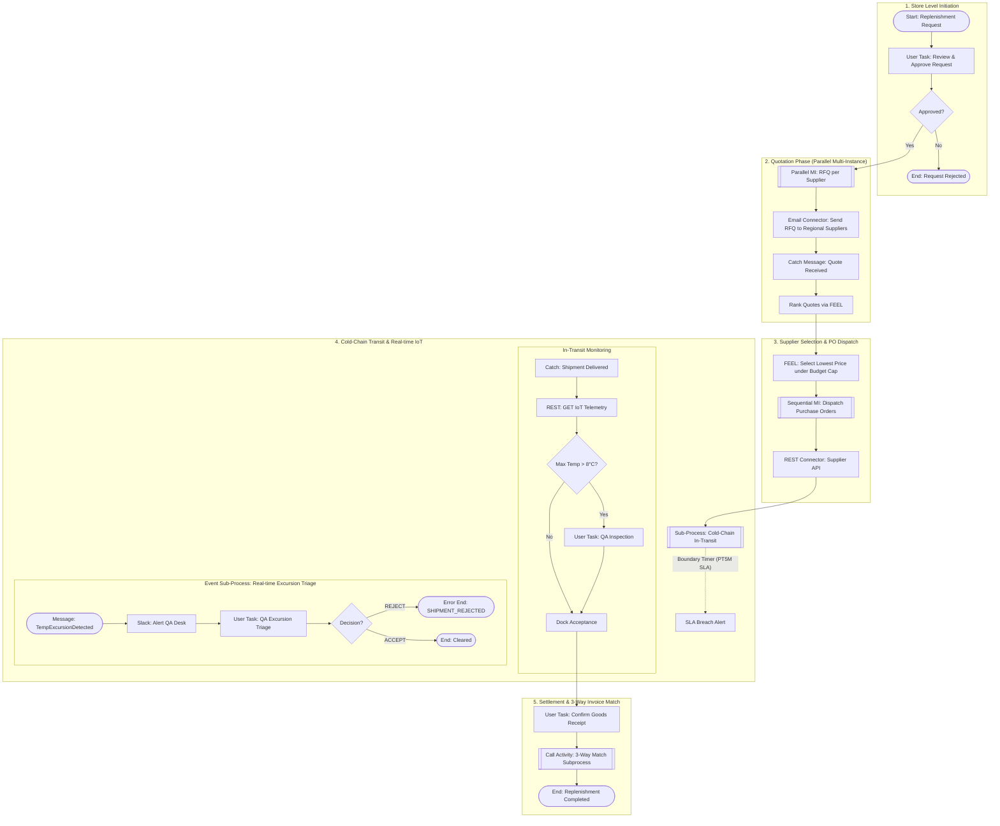

# Perishable Cold-Chain Grocery Replenishment Platform
### Camunda 8 (Zeebe 8.5+) BPMN Orchestration & Real-Time Stitch UI Frontend

[](https://github.com/eksingh567/Perishable-Cold-Chain-Grocery-Replenishment/actions/workflows/deploy.yml)
[](https://nodejs.org)
[](https://camunda.com)
[](LICENSE)

> **Live Interactive Frontend Demo**: [https://eksingh567.github.io/Perishable-Cold-Chain-Grocery-Replenishment/](https://eksingh567.github.io/Perishable-Cold-Chain-Grocery-Replenishment/)

---

## 1. Project Overview

Inspired by automated e-grocery supply chains (e.g., Ocado, Carrefour), this platform coordinates end-to-end cold-chain grocery replenishment for perishable goods (milk, yogurt, berries, artisanal cheeses). 

The platform integrates:
- **Camunda 8 (Zeebe 8.5+) Workflow Engine**: Orchestrating parallel supplier RFQs, sequential purchase order dispatches, FEEL price-ranking, delivery SLA boundary timers (`PT5M`), non-interrupting IoT temperature excursion event sub-processes, and automated three-way invoice matching.
- **Real-Time Stitch UI Frontend**: Modern logistics command center built with high data density, dark-slate cockpits, interactive SVG telemetry charts, real-time alerts, and embedded Camunda Forms v16.
- **Zero-Dependency Mock Server & REST API**: Native Node.js server simulating IoT telemetry packets, WireMock contracts, and Zeebe user task completions.

---

## 2. System Architecture



---

## 3. Interactive Frontend Screens (Stitch UI)

The frontend contains two production-grade dashboards equipped with active JavaScript event handlers, audio synthesis cues, and interactive modals:

### Screen 1: Command Dashboard (`index.html`)
- **Live URL**: [index.html](https://eksingh567.github.io/Perishable-Cold-Chain-Grocery-Replenishment/)
- **Key Capabilities**:
  - **KPI Metrics**: Active Replenishment Batches, Cold-Chain IoT Fleet Avg Temp (3.8°C), RFQ Turnaround (1.4h), 3-Way Match Success Rate ($4,850 matched under $5,000 budget cap).
  - **In-Transit Telemetry Card**: Live telemetry stream for Truck #TK-882, real-time temperature graph with critical 8.0°C SLA limit line, and interactive `Simulate Excursion Trigger` button.
  - **Camunda Pending User Tasks**: Interactive cards for `Review & Approve Request`, `QA Excursion Triage`, and `AP Clerk Discrepancy Review` with live completion and rejection state machines.
  - **Replenishment Table**: Live status badges, stage filters (`All`, `In-Transit`, `Pending QA`, `Settlement`), pagination, and detailed shipment lifecycle modals.
  - **New Replenishment Modal**: Fully interactive form to start a new Camunda Zeebe process instance.
  - **Settings Drawer & Notification Center**: Configurable temperature SLA limits, timer sliders, and real-time engine alert center.

### Screen 2: QA Excursion Triage & Telemetry (`qa-triage.html`)
- **Live URL**: [qa-triage.html](https://eksingh567.github.io/Perishable-Cold-Chain-Grocery-Replenishment/qa-triage.html)
- **Key Capabilities**:
  - **Event Sub-Process Monitor**: Correlated to Camunda message `TempExcursionDetected` on Shipment #SHP-405.
  - **Sensor Diagnostics**: Core temp (8.4°C critical alert), ambient cabin temp, and compressor fault diagnostic `ERR-402`.
  - **Embedded `qa-decision.form`**: Interactive radio selection cards for `REJECT SHIPMENT`, `ACCEPT WITH EXPEDITED QA`, and `REROUTE TO COLD STORAGE` with rationale validation and Zeebe gRPC commit feedback.
  - **Dock QA Checklist (`qa-inspection.form`)**: Interactive probe test, visual checks, lot number verification, and tamper seal indicators with dynamic progress tracking.
  - **Quarantine Shipment Modal**: Emergency quarantine trigger diverting carrier to cold storage.
  - **Export Audit Trail**: Generates and downloads a real `coldchain-audit-trail-SHP-405.json` file.
  - **Live Audit Timeline Drawer**: Collapsible execution log detailing the exact millisecond-level Zeebe sequence.

---

## 4. Camunda 8 BPMN Models & Forms

### BPMN 2.0 Definitions (`Backend/bpmn-models/`)
1. **`cold-chain-replenishment-main.bpmn`**:
   - Process ID: `coldChainReplenishment` (Executable)
   - Features: Multi-Instance parallel RFQ subprocess, sequential PO dispatch, boundary timers, and error catches (`SHIPMENT_REJECTED`).
2. **`supplier-invoice-three-way-match.bpmn`**:
   - Process ID: `supplierInvoiceThreeWayMatch`
   - Reusable Call Activity evaluating:
     $$\text{Match Status} = \begin{cases} \text{"MATCHED"}, & \text{if } Q_{\text{ord}} = Q_{\text{recv}} \land A_{\text{ord}} = A_{\text{inv}} \\ \text{"DISCREPANCY"}, & \text{otherwise} \end{cases}$$

### Camunda Forms Schema v16 (`Backend/bpmn-models/forms/`)
- `review-replenishment-request.form`: Store manager budget & parameter sign-off.
- `qa-decision.form`: Real-time incident triage during temperature excursion alert.
- `qa-inspection.form`: Receiving dock sensory and probe temperature protocol.
- `confirm-goods-receipt.form`: Warehouse pallet receipt, batch lot, and shelf life verification.
- `ap-clerk-manual-review.form`: Accounts payable exception dispute & bypass resolution.

---

## 5. Local Setup & Quick Start

### Prerequisites
- [Node.js](https://nodejs.org/) (v18 or v20+)
- Git

### 1. Clone & Run Locally
```bash
git clone https://github.com/eksingh567/Perishable-Cold-Chain-Grocery-Replenishment.git
cd Perishable-Cold-Chain-Grocery-Replenishment

# Start the full-stack server
npm start
```
Open **[http://localhost:3000](http://localhost:3000)** in your browser to access the dashboard!

---

## 6. Automated Testing

The repository contains an automated test suite verifying:
- BPMN 2.0 XML schema and element definitions.
- Camunda Form Schema (v16) component structure across all 5 forms.
- Mock contract schema and start payload integrity.
- Frontend DOM, button ID bindings, and modal presence.
- REST API endpoint health and response payloads.

Run all tests with:
```bash
npm test
```

### Test Suite Output
```text
TAP version 13
# Subtest: 1. BPMN Models Integrity & Schema Verification
ok 1 - 1. BPMN Models Integrity & Schema Verification
# Subtest: 2. Camunda Forms Schema (v16) Verification
ok 2 - 2. Camunda Forms Schema (v16) Verification
# Subtest: 3. Mock Telemetry & Start Payload Contracts
ok 3 - 3. Mock Telemetry & Start Payload Contracts
# Subtest: 4. Frontend Pages, Buttons & Component Auditing
ok 4 - 4. Frontend Pages, Buttons & Component Auditing
# Subtest: 5. Local Server & REST API Endpoints Verification
ok 5 - 5. Local Server & REST API Endpoints Verification
1..5
# tests 5
# pass 5
# fail 0
```

---

## 7. CI/CD & Deployment

Every commit to the `main` branch automatically triggers the GitHub Actions workflow [`.github/workflows/deploy.yml`](.github/workflows/deploy.yml):
1. **Continuous Integration**: Runs the automated test suite on Ubuntu Node.js 20.
2. **Continuous Deployment**: Deploys the static production assets from `./frontend` directly to **GitHub Pages**.

---

## 8. License

This project is licensed under the MIT License. See [LICENSE](LICENSE) for details.
